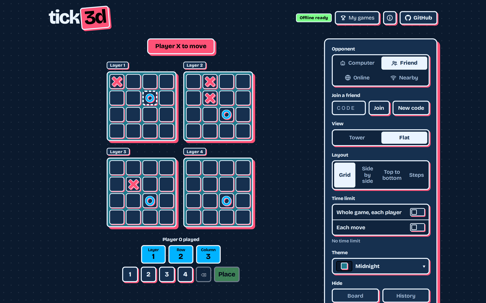
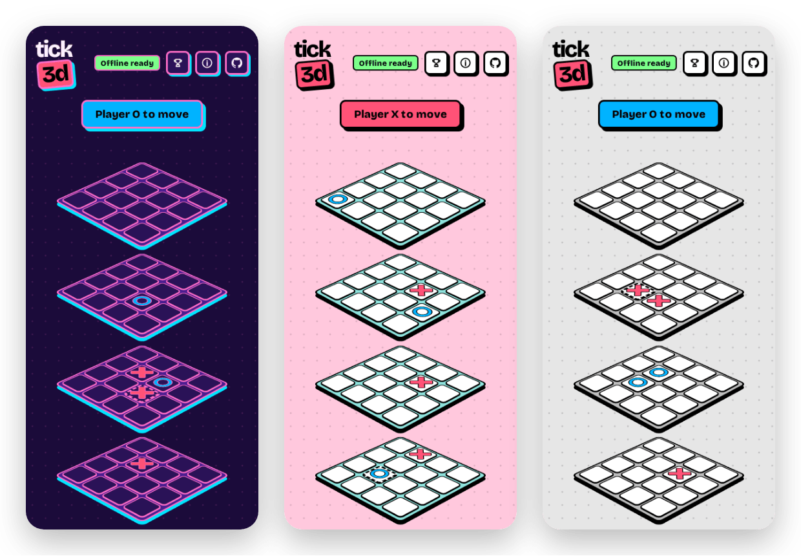
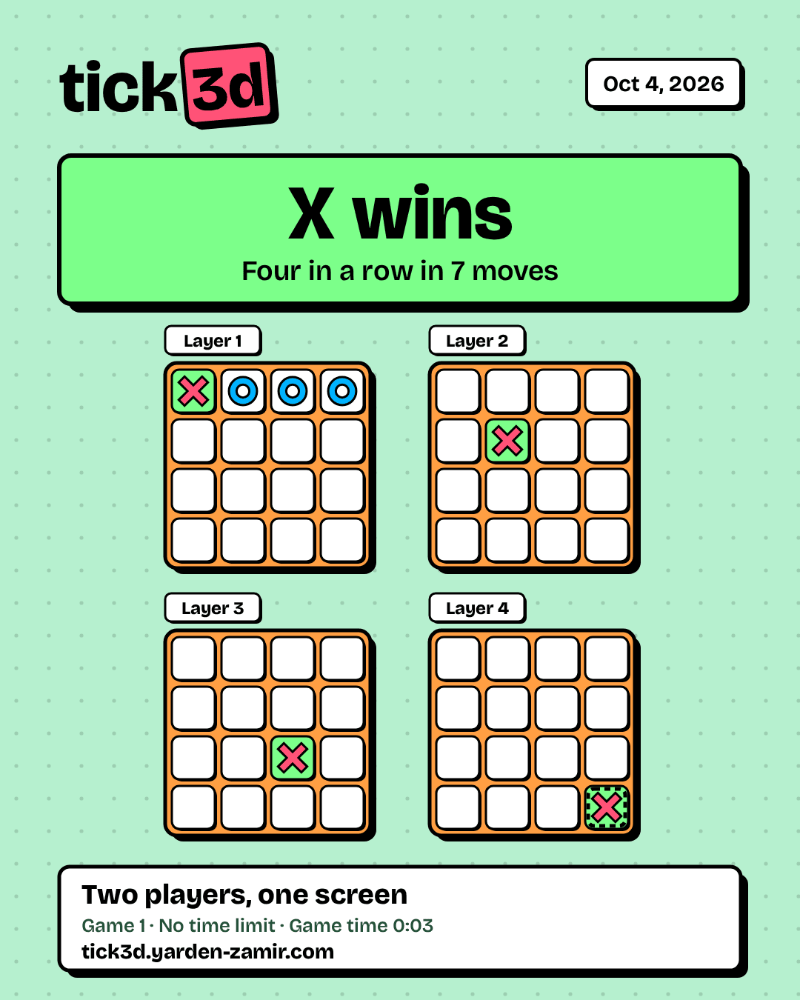
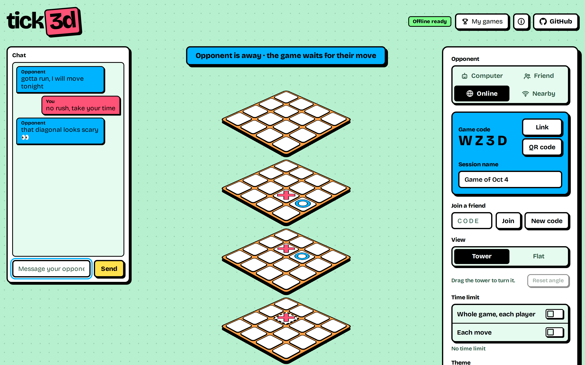
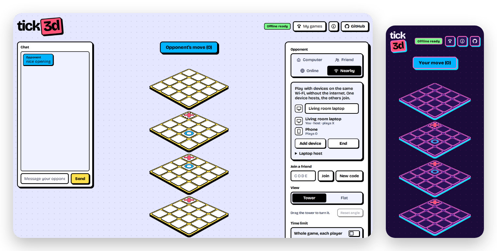
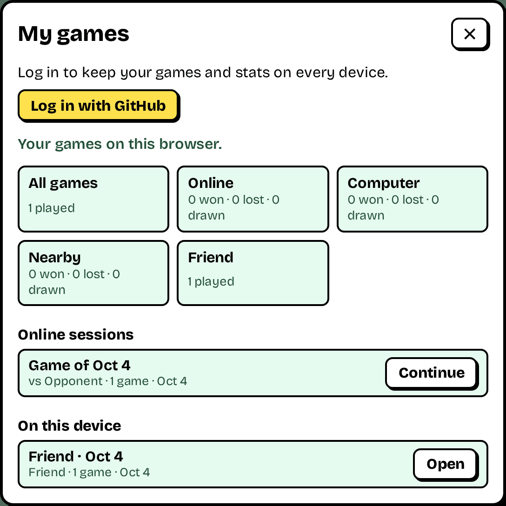

# tick3d

[](https://tick3d.yarden-zamir.com)

3D tic-tac-toe on a 4×4×4 cube, at [tick3d.yarden-zamir.com](https://tick3d.yarden-zamir.com).


[](https://raw.githubusercontent.com/Yarden-zamir/tick3d/pr-assets/issue-119/renders/a89435f/spot/tick3d-spot-a89435f-landscape.mp4)
## Rules

- Two players take turns. X moves first.
- Four marks in a straight line win. The cube has 76 lines.
- In an online or Nearby session, X and O swap for each new game, so the first move alternates. Against the computer you start every game unless you unlock the seats.
- A full cube with no line is a draw.

[](https://raw.githubusercontent.com/Yarden-zamir/tick3d/pr-assets/issue-119/renders/a89435f/tutorial/tick3d-tutorial-a89435f-landscape.mp4)

## Features

- Play against the computer, a friend on the same device, a friend online, or a device on the same Wi-Fi (Nearby).
- Three computer levels: easy (the default), medium and hard. Easy always blocks the first winning threat of a game, and later blocks only by chance. "Advanced: computer player" in the More card tunes each level. A game is tuned when the computer made at least one move with changed settings, also if the settings changed back later. The end card, My games, the records and the stats show it.
- Two views: a 3D tower that you turn with a drag, and a flat view with four layouts.
- Play by coordinates on the keypad. The keypad shows only while the board is hidden.
- Hide goes in steps: the history, then the board too, then the coordinates too.
- After the first two wins in a row against easy, the page moves the player up to medium once, with a short animation (`src/page/level-up.ts`).
- The edge of the screen takes the color of the player to move, and pulses slowly on your turn.
- A muted speaker button turns red.
- Time limits per game, per move, or both. A player who runs out loses.
- Lock: no setting changes until the game ends.
- Seat lock: keeps X and O between games. It sits next to "You play" (computer) and in the Players box (online, Nearby). Either player can change it.
- Sound sets where each cell has its own sound, and an ear trainer at `/sound-training`.
- One sound rule on every page: a press on a button, switch or menu item clicks at once. A control with its own sound (a move, a refusal, a sample, a song) plays only that sound. Disabled controls stay quiet, and the mute holds.
- Play by voice (in the More card): tap the mic, then hold a note on a free cell for 1 second to place your move. On a phone, turn on Tilt in the Voice room settings (off by default): a small tilt nudges the cell up to 3 cells.
- Voice only: the arrow next to the mic opens the voice options. With Voice only on, a tap on the board or the keypad places nothing while the voice is on, and the board area takes a tint.
- The Voice room at `/sound-input`: calibrate the mic to your voice, then practice with Free play, Targets, Echo, or a Playoff against the other player of an online game. The page finds the pitch on the device and sends no sound.
- Your game as a song: the Song button on the end card and on a game link. A long press shares the song as a WAV file, with your voice on the moves that your voice placed.
- An end card with the result, to share or save as an image.
- Survival records: the longest game against each computer level and setup.
- Achievements: 51 goals such as a first win, a win in 7 moves or 5 wins in a row (`src/achievements.ts`). Some goals are ladders with a step per computer level, where a higher step also unlocks the lower ones. A person never counts for a computer level; themed goals have their own achievement for people. The tier color shows how hard a goal is, from stone to a moving mythic foil. Hidden goals show a question mark until they unlock. The goals about people (different people, a nemesis, a revenge) need the server, which knows each opponent. Past games count too, and a friend game with a winner counts as a win, but friend games count for no ladder. Three goals count invites (1, 5 and 25 people): see the share page below. My games and the stats page list them with their rarity ("12% of players"), and the end card and the shared image show a new one. An unlock that this device did not show on an end card, such as an invite or a game on another device, pops up in a card at the bottom of the game page when the page opens or comes back to the front (`src/page/achievement-popup.ts`). The card lists the 3 newest, with "+N more" that opens My games. The device keeps the achievements that it showed in localStorage, so each one pops once. "Clear history" keeps them, and "Reset achievements" in My games starts them over.
- Twelve themes.
- The same header on every page, with My games and Info, and the same footer, with kitshn and GitHub (`src/header/`).
- Info on the game page shows the tutorial video "How to play" (Basics). The slider under it jumps between the checkpoints of the video, and the headline of each checkpoint shows over the slider while you drag. The checkpoints come from the video plan (`src/tutorial-chapters.json`, written by `video/scripts/tutorial.ts`). The page loads a small web copy of the video from `public/tutorial/` on the first open of Info.
- The kitshn button lists the production site and the open pull request previews. A stacked pull request shows inside its parent.
- The browser keeps the settings in `localStorage`, and the page checks each stored value.







## Game links and match history

- Every finished game gets a read-only link, for example `/?game=AB3K-2` (online) or `/?game=K7P2QX9M` (other modes).
- My games lists every finished game, newest first, and can clear the history.

## Online play

- Choose Online to create a session with a 4 character code (`?code=AB3K`). Share the link or the QR code.
- The creator plays X, the first other browser plays O, and further browsers watch.
- Either player controls the seats. A change to the other player's seat, and an undo, waits until that player accepts.
- After each new game, the seats swap unless a player locked them. The score and My games count each game for the player who played it.
- Chat, the hide options, the lock and the time limit belong to the session, so both players share them.
- Before the first chat message, the chat shows only its title and the message field. The message log shows from the first message on, with the game events of the session.
- The server decides a timeout, so a page that closes cannot avoid a loss on time.
- A session with moves never expires. A player can leave and come back, so a game can run asynchronously.
- A page reads the game again when it comes back to the front, and when it refuses a move as not its turn. After a server restart, it opens a new live stream (`subscribe` in `src/online.ts`).

### Report and block

- Hold, right-click, or press the context-menu key (Shift+F10) on a chat message, a player or a watcher. A small menu offers Report and Block.
- Block hides the person's messages, and shows a generated name and picture in place of theirs. The server keeps the list per player, so it follows a GitHub login. Unblock in My games.
- Report sends a reason and a short note to the maintainers, and hides that message on your device. Report works in Online games only: the server cannot see a Nearby game.
- On the stats page, the player card of a person view has Report or block, with the same menu. The leaderboard leaves out the people that you blocked.
- Each person has a public person id, a hash of the player token. A chat message keeps the person id of its author, so it stays with the author when the seats change. Older messages have none: they show with the player on their seat.
- The maintainers (GitHub logins Yarden-zamir and TomCohenDev) read the reports with `GET /api/reports`. They can hide a message for everyone or clear a custom name, and the server logs each action.



## Play with an AI agent

- An AI agent plays through the HTTP API, with no account and no key.
- In computer mode, open More, then "Advanced: computer player", and copy the text under "Play with your AI agent". Give it to your agent.
- The text points the agent to `/api/openapi.json`. The agent can play you or another agent.

## Offline play

- After the first visit, a service worker keeps the page, so the game opens without a network. The game is installable.
- Computer, friend and Nearby games run on the device and stay in IndexedDB. The device uploads results when it has a network.
- After a deploy, the page shows "New version ready" with a Reload button.
- A game in progress continues through a deploy, with no reload. A page that cannot read an answer of the new server loads the new version by itself, and the online game opens again.
- Safari deletes the data of a site that you do not open for 7 days, unless you add the game to the home screen.

## Wi-Fi (Nearby)

- Choose **Here** for two people sharing one screen. Its icon follows the device: phone, tablet or computer.
- Choose **Online** when both devices have internet, even when sitting together. **Wi-Fi** (the Nearby mode in the API and stored data) also works without internet. Both devices must use the same Wi-Fi, and the network must allow devices to communicate.
- Open the app once on both devices while online so the game and scanner are saved for offline use.
- Choose **Start a game** on one device and **Scan to join** on the other. Scan inside tick3d, then show the joining device's new QR to the starter. The starter taps **They’ve scanned — scan back** and scans it. Both devices enter the game without changing apps or tabs.
- Online, the hosted game shows in "Games near you" on the other devices of the same network.
- **Other ways to connect** keeps text codes to copy and paste, and existing camera-app links still work. Camera access is requested only when scanning; images stay on the device. The camera stops after a scan, on cancel, when switching modes, or when the page goes into the background.
- Under **Other ways to connect**, **Listen for reply** on the starter and **Send reply by sound** on the joining device replace the return scan after the first QR. The optional sound sends the real compressed WebRTC reply in error-corrected packets, tied to the current invite. It is not just the demo jingle: a full reply takes longer, with packet progress shown. Only the receiver requests a microphone, and both controls can stop immediately. QR and text stay available. The decoder and audio worklet are cached for offline use; audio stays on the devices, and voice play pauses during the transfer.
- If Online is reachable, Wi-Fi shows a nonblocking **Play online instead** suggestion. The list and suggestion depend on an actual server response, not the browser's online flag.
- Keep the starter's device open. Its screen wake lock is requested again when the app returns to the foreground. If a guest disconnects, the host keeps their game and seat; use **Add device** and **Scan to join** again.
- The devices talk directly over WebRTC. The host's device holds the session and checks every move with the same rules as the server.
- To host a full server on a laptop, run `docker compose -f compose.lan.yml up --build`. Others open `http://<that computer's address>:8080` and play Online. Set `LAN_HOST_NAME` for the host name and `LAN_PORT` for another port.



## Controls per mode

The panel column starts with the game actions: the score, New game, then Undo or the result card and the sound, in two taller slots. Under them are two cards. The settings card holds Opponent, Difficulty, the Online and Nearby boxes, and Players. The second card, More, starts closed on every load and opens on a press. It holds View and Layout, You play, Time limit, Hide and Lock, Theme, Play by voice, the ear trainer and Voice room links, and "Advanced: computer player".

In one column (52rem and narrower) the panel column sits under the board. While the settings card is out of view, a gear at the bottom right of the screen scrolls to it (`src/page/settings-hint.ts`).

The panel shows a control only in the modes where it applies (`data-show-mode` and `data-needs-session` in `index.html`). A finished game from a link shows only the controls for looking at it.

| Control | Computer | Friend | Online | Nearby | Game from a link |
| --- | --- | --- | --- | --- | --- |
| Opponent, view, layout, theme, sound | yes | yes | yes | yes | yes |
| Difficulty, You play, Advanced | yes | no | no | no | no |
| Seat lock (keep X and O between games) | next to You play | no | in the Players box | in the Players box | no |
| Game code, Link, QR code, session name | no | no | yes (grey until a game starts) | no | no |
| Host, Join with a code, Games near you, device list | no | no | no | yes | no |
| Join a friend (code and New code) | no | no | yes | no | no |
| Players (seats, watchers and seat controls) | no | no | yes (grey until a game starts) | yes (grey until a game starts) | no |
| Time limit | yes | yes | yes | yes | no |
| Hide (history, then board, then coordinates) | yes | yes | yes (off until a game starts) | yes (off until a game starts) | no |
| Lock (rules of the live game, for both players) | no | no | yes (off until a game starts) | yes (off until a game starts) | no |
| Score, New game, the session games in My games | yes | yes | yes (grey until a game starts) | yes (grey until a game starts) | yes (no session games) |
| Undo (during a game) | no (shows disabled) | yes | for a player in a game (asks the other player) | for a player in a game (asks the other player) | no |
| Result card (after a game) | yes | yes | in a game | in a game | no |
| Chat | no (a wide screen keeps its space) | no | yes | yes | no |
| Report and block (hold or right-click a person) | no | no | yes | Block only | no |
| Play by voice | yes | yes | with a seat | with a seat | no |

"In a game" and "a game starts" mean after a create or a join (Online), or after Host or Join (Nearby).

Before a game starts, a control of a game (`data-needs-session`) draws at once in its final place, grey and disabled (`data-pending` in `src/style.css`). The Players box shows two "Waiting…" seats with grey pictures, and the clocks of a time limit keep their place. When the server or the Nearby host answers, the page fills in the real values, and nothing moves. If the server fails, the error shows and the controls stay grey in their place.

The actions row has fixed slots (`.slot-row` in `src/style.css`), so a control that shows or hides never moves another control. `e2e/row-layout.spec.ts` checks this.

A mode change moves neither the board nor the Opponent picker:

- Everything above the picker keeps its box in every mode, also the game actions above the settings card. Before a game, the score and New game show grey and disabled in their place. The Players box sits under the mode boxes.
- A wide screen (72rem and wider) keeps the chat column in every mode. Outside a game with another device, that column stays empty.
- On a phone the chat opens above the panel. If the player works in the panel, the page scrolls by the height of the chat, so the panel stays still (`src/page/panel-anchor.ts`).

## Accounts and My games

- Login with GitHub is optional. Without a login, every browser plays with a random token and a generated name, such as "braveOtter".
- A login lets a player continue a game on every device of the account.
- A player without a login can choose a name in My games.
- My games shows the account, the stats, the games of the open session, the match history and the online sessions. Stats in its head opens your own stats.



## Code

- `src/game.ts`: board, lines, move validation, win and draw.
- `src/ai.ts`, `src/ai-worker.ts`, `src/move-search.ts`: the computer levels, in a Web Worker.
- `src/session/core.ts`: the session rules. The server, the device and the Nearby host all run them.
- `src/session/format.ts`: the stored session format.
- `src/protocol.ts`: the contract between the page and the API.
- `src/online.ts`: the API client. `src/local.ts` and `src/device-db.ts`: the device backend on IndexedDB.
- `src/nearby/`: WebRTC, QR codes and the host and guest sessions.
- `src/sound.ts`, `src/sound-sets.ts`: the sounds and the sound sets. `src/click-sound.ts`: the click of every control. `src/song.ts`: a finished game as a song.
- `src/voice/`: the voice engine (pitch, range, sticky cells, tilt, clips) for the game and the Voice room. `src/page/voice.ts`: play by voice in the game.
- `sound-input.html`, `src/sound-input/`: the Voice room. `src/practice/`: the practice and playoff rules, shared with `server/practice.ts`.
- `src/main.ts`, `src/page/`, `index.html`, `src/style.css`: the game page, one module per feature in `src/page/`.
- `src/page/safety.ts`, `src/page/person-mark.ts`: the report and block menu of the game. `src/safety-dialog.ts` and `src/blocks.ts`: the menu and the block list, shared with the stats page.
- `src/header/`: the header and the footer of every page. `src/markup.test.ts` checks that every page has the same header and footer.
- `stats.html`, `src/stats/`: the stats page. `sound-training.html`, `src/sound-training/`: the ear trainer.
- `share.html`, `src/share/`: the share page. `server/tester-codes.ts`: the codes from `TESTER_CODES`.
- `src/pwa.ts`, `vite.config.ts`: the service worker and the manifest.
- `server/main.ts`: the HTTP API. `server/store.ts`: the DuckDB store. `server/auth.ts`: GitHub login.
- `server/api-docs.ts`: every API route with its docs. The server finds routes in this list.

To add a route, add one entry to `ROUTES` in `server/api-docs.ts` and one case to the switch in `server/main.ts`. The type check fails when one of the two is missing.

The page is plain TypeScript built with Vite, with no runtime dependencies. The API runs TypeScript directly on Node 26 and stores data in [DuckDB](https://duckdb.org).

## Stored data and format changes

- The server and the device store a session as the same document, with a `format` number.
- A new optional field needs only a default in `parseDoc` (`src/session/format.ts`). It needs no migration and no database reset.
- A breaking change needs a new `CURRENT_FORMAT` and one `UPGRADES` step. `src/session/format.ts` explains the rules.
- `src/session/fixtures/` holds a document of each released format. A test reads each one.
- Table changes are append-only statements in `server/store.ts`, such as `ALTER TABLE ... ADD COLUMN IF NOT EXISTS`.
- A one-time data change runs through `runOnce` in `server/store.ts`: the `migrations` table keeps its name, so it runs once per database.

## API

- `/api/openapi.json`: the OpenAPI 3.1 document, with every route, shape, error and a curl example.
- `/api/docs`: the same document in Swagger UI.

Both come from `server/api-docs.ts`. The routes that change a game accept an `Idempotency-Key` header, and every 429 has a `Retry-After` header.

## Stats page and what is logged

- `/stats` is public: the game Info panel and My games link to it, and search engines may list it.
- Filters: Everyone or Mine, the time (7 days, 30 days or all), the mode and the level. The address holds them, for example `/stats?scope=mine&range=30d`. `GET /api/stats` takes the same query and answers 400 for an unknown value.
- A person filter (`/stats?person=<person id>`) shows the games of one person, with their name and picture. A click on a person's picture in the game opens it large, with a Stats link to this view.
- "Hide my stats" in My games closes your person view, your achievements included, to everyone but you: `GET /api/stats` and `GET /api/stats/card/{person}` then answer 403. It also takes you off the leaderboard. Mine still works, and Everyone still counts your games without your name. The setting follows a GitHub login.
- Leaderboard (Everyone only): one row per player with their name, GitHub login and picture, and games, won, drawn, lost, win rate, best streak, fastest win, average moves, achievements and last game. Tap a column to sort; tap it again to turn the order around. It follows the time, mode and level filters, and loads when it scrolls into view. The achievements count covers all games. Friend games and the computer do not count. Players that you blocked are not on your board. `GET /api/leaderboard` gives the same rows.
- Everyone answers (the stats and the leaderboard) come from a snapshot. A second database connection refreshes it in the background when it is a minute old, or older for a costly refresh, so a visitor and the game never wait for it. With more than 100,000 games, the charts of moves, times, settings and devices show the newest 100,000.
- Speed: the queries read plain columns that each write copies out of the stored game (`server/fields.ts`), and the games of one player come through indexes on the seat columns. At 1,000,000 players (5,000,000 games) every request of one player answered in under 1.5 s.
- A tap on a row opens the person view. Its player card shows the unlocked achievements in a row that scrolls, newest first, and Report or block. The card has its own request (`GET /api/stats/card/{person}`), which reads no game, so it shows before the stats of the person.
- On a phone, the player column of the leaderboard stays in view and cuts off long names, so about 4 number columns fit next to it.
- While the stats load, the cards show as grey skeletons with a moving light, and then fade in. With reduced motion, the skeletons stay still.
- Everyone shows counts only, apart from the leaderboard: no player names and no page faults. Mine (your games on every linked device) adds your win rate over time, streaks, results, survival records and favourite opponents. A person view adds the same, without the opponents.
- The stats never show a token, a result id or a game id.
- A finished game sends, besides the game: the device kind, the view, the layout, the theme, input and undo counts, refusals, computer thinking times, the offline flag and the app version.
- A fault report holds the error message, the file and line, and the app version. It holds no token and no address.

## Share page

`/share` holds the invite link and the steps to join the closed test: Android (Google Group, Play testing, a free Google Play promo code, install) and iPhone (TestFlight). The page was `/testing` before: `/testing` redirects to `/share` (`container/Caddyfile`), and `testing.tick3d.yarden-zamir.com` redirects there on production (`Caddyfile.j2`), both with the query, so the links sent before the rename keep working.

- The codes come from the GitHub secret `KITSHN_TESTER_CODES` in the Environment `prod`, never from git: one entry per line or comma. `CODE` is a free code, and `CODE=Name` is a code that Name has already. A code has 10 to 30 characters from A-Z and 0-9.
- At start, the API adds the codes that it does not hold yet. A known code keeps its row and its claim. A bad entry stops the start. Only production reads the secret, so a preview shows no codes.
- A claim stores the email and the name that the tester types, the player token of the claimer and its owner then, and the person id of the inviter. The page shows the name and the Gravatar picture of each claim, never the email or a full code. `GET /api/testing/claims` gives the emails and the inviters to the maintainers, to add them to the Google Group.
- Each code keeps its slot (#1, #2, ...): the order of the secret, with later codes at the end. The page refreshes the list every 20 s and when it comes back into view, and turns a claimed card in its place.
- One address can claim 5 codes per hour. The browser keeps its codes in localStorage and shows them on the next visit.
- The 15 s trailer (`public/trailer/`, 1.4 MB: 1280×720, x264 two-pass at 700 kbit/s with `-tune animation`, AAC 80 kbit/s, faststart) plays at the top without sound, once the browser expects to play it without a stop. A tap turns the sound on for one run: at the end the trailer starts again without sound. With reduced motion, it waits for a tap. A new encode gets a new file name, so no cache serves the old one.
- The count of free codes is a button: it scrolls to the first free card and makes it pulse.
- Share with a friend shares only the invite link `<origin>/share?by=<person id>`, with the public person id of the sharer. The Share button of the game header offers the same link ("Share tick3d"), and "Play online with a friend": a new online game, as the Online choice starts one, and its play link. The iOS app hides "Share tick3d", because `/share` offers Google Play codes.
- The page keeps the first valid `by` in localStorage, and a claim sends it. The server stores it as `invited_by` on the code. An invite from the claimer's own person (a device or the account) counts for nobody.
- Copies of the paid Android app (`src/copies.ts`): the native launch activity opens Chrome and establishes its validated message channel. The page requests a five-minute, one-time server nonce with its existing `X-Player`, then sends that nonce to the native activity. The activity returns a classic Play Integrity token and the Play Install Referrer over the channel. The page submits the proof with the same player token to `POST /api/copies`. The server calls Google's `decodeIntegrityToken`, checks the nonce's player, freshness and single use, timestamp, package, `PLAY_RECOGNIZED` and `LICENSED`, then records a proved copy. A launch referrer alone proves nothing. Without a network or a message channel the app opens without a new proof. Existing copies stay unproved until a verified open. The channel needs Chrome 115 or later and the `use_as_origin` relation in the site's Digital Asset Links.
- The copy belongs to the account that is logged in on that device now, or to the device without a login. A login with another account on the device moves the copy to that account, and a logout moves it back to the device. So one copy serves one account at a time. No step on the page is needed.
- `GET /api/me` gives `hasCopy`: true on every browser of an account that holds a copy, the web too.
- A valid, player-bound `UNLICENSED` Play verdict clears `proved` on that device only. `UNEVALUATED` (Google could not decide) answers 403 and changes nothing. Other proved devices of the account keep their copies. A malformed, stale, reused or wrong-player proof cannot revoke a copy. Apple refunds are not checked; revisit when a player reports a refund.
- The invite achievements count distinct people: the claims and the app opens with that inviter, merged when they share a device, an owner or the account that holds a device now (`server/invite-people.ts`). A claim in the browser, a later login and the app on the same phone count once, and so do two devices of one account, also when a device logs in after its event. The claims from before the invite links count as invites of Yarden, except the codes that he gave to himself (a one-time migration in `server/store.ts`).
- The iPhone app reports StoreKit 2 `AppTransaction` through a small Capacitor plugin. The server verifies its signed data with Apple's App Store Server Library, the bundle identifier, app identifier and environment. Apple's `appTransactionId` identifies an app purchase; `originalTransactionId` belongs to in-app purchases and is not present here. The plugin also sends `AppStore.deviceVerificationID`, and the server checks it against the signed `deviceVerification` hash. One purchase holds at most five devices (`apple_slots`), keyed by that id, so a copied proof cannot fill other slots. A new player token on the same device takes its slot over. A device cannot switch Apple purchases. Delete my data frees the slot, and a device unused for 90 days frees its slot when a new device needs it. TestFlight gets copies while it stays invite only; revisit when the TestFlight link becomes public. The iPhone browser storage is separate from Safari, so only an inviter visible inside the app can count.

Run it locally with fake codes:

```sh
TESTER_CODES="AAAAAAAAAAAAAAAAAAAAAA1=Tom,BBBBBBBBBBBBBBBBBBBBBB2" DB_PATH=/tmp/share.duckdb node server/main.ts
```

## Develop

Node is not necessary on the host. Run the commands in a container:

```sh
docker run --rm -v "$PWD":/app -w /app node:26-alpine sh -c 'npm ci && npm run check && npm run build'
docker run --rm -it -p 5173:5173 -v "$PWD":/app -w /app node:26-alpine npx vite --host
```

- `npm run check` runs the type check, the linters (`npm run lint`) and the unit tests.
- `npm run build` runs the type check and the Vite build.
- `npm run api` starts the API on port 8080 with `./dev.duckdb`.
- `npm run dev` starts the Vite dev server on port 5173. It sends `/api` calls to `npm run api`, so run both for Online games.

`npm run e2e` runs the Playwright tests in `e2e/` against a deployed site. Set `E2E_BASE_URL` to the site, for example a pull request preview:

```sh
docker run --rm --ipc=host -v "$PWD":/app -w /app -e E2E_BASE_URL=https://pr-17.tick3d.yarden-zamir.com mcr.microsoft.com/playwright:v1.63.0-noble sh -c 'npm ci && npm run e2e'
```

- Keep the image tag equal to the `@playwright/test` version in `package.json`.
- After a run in the Playwright image, run `npm ci` again before you use `node:26-alpine`.
- The `e2e` workflow runs the suite after each successful pull request preview deploy. It starts when the preview answers its health check 3 times in a row.

## Video

`video/` holds a 15 s ad and two tutorials, "How to play" (Basics) and "Strong cells", made in code: three.js draws every frame, Remotion renders it, and the sound comes from the game's own sound code. The creative (brief, script, timeline, music notes and the tutorial plan) is in [video/creative/](video/creative/).

**The ad** (15 s): [landscape MP4](https://raw.githubusercontent.com/Yarden-zamir/tick3d/pr-assets/issue-119/renders/a89435f/spot/tick3d-spot-a89435f-landscape.mp4) · [portrait MP4](https://raw.githubusercontent.com/Yarden-zamir/tick3d/pr-assets/issue-119/renders/a89435f/spot/tick3d-spot-a89435f-portrait.mp4) · [stills](https://raw.githubusercontent.com/Yarden-zamir/tick3d/pr-assets/issue-119/renders/a89435f/spot/tick3d-spot-a89435f-stills.png)

**The tutorial "How to win"** (40 s): [landscape MP4](https://raw.githubusercontent.com/Yarden-zamir/tick3d/pr-assets/issue-119/renders/a89435f/tutorial/tick3d-tutorial-a89435f-landscape.mp4) · [portrait MP4](https://raw.githubusercontent.com/Yarden-zamir/tick3d/pr-assets/issue-119/renders/a89435f/tutorial/tick3d-tutorial-a89435f-portrait.mp4) · [stills](https://raw.githubusercontent.com/Yarden-zamir/tick3d/pr-assets/issue-119/renders/a89435f/tutorial/tick3d-tutorial-a89435f-stills.png). The short cut (27.5 s): [landscape MP4](https://raw.githubusercontent.com/Yarden-zamir/tick3d/pr-assets/issue-119/renders/a89435f/tutorial-short/tick3d-tutorial-short-a89435f-landscape.mp4) · [portrait MP4](https://raw.githubusercontent.com/Yarden-zamir/tick3d/pr-assets/issue-119/renders/a89435f/tutorial-short/tick3d-tutorial-short-a89435f-portrait.mp4) · [stills](https://raw.githubusercontent.com/Yarden-zamir/tick3d/pr-assets/issue-119/renders/a89435f/tutorial-short/tick3d-tutorial-short-a89435f-stills.png).

The files are the render of commit a89435f on the `pr-assets` branch. A new render goes to a new folder (`video/scripts/publish.sh`); update these links when one replaces them.

```sh
docker run --rm -v "$PWD":/app -w /app/video node:26 sh -c 'npm ci && npm run check && npm run video'
```

- `npm run video` writes `video/out/tick3d-15s-landscape.mp4` (1920×1080), `video/out/tick3d-15s-portrait.mp4` (1080×1920), one still per bar in `video/out/stills/` and the soundtrack in `video/out/soundtrack.wav`.
- `npm run tutorial` renders the Basics tutorial "How to play" (48 s) in both crops into `video/out/tutorial-basics/`, with one still per checkpoint, the web copy and poster for the Info panel, and `src/tutorial-chapters.json`. `TUTORIAL=strong npm run tutorial` renders "Strong cells" (17 s) into `video/out/tutorial-strong/`; the app does not use it yet. `TUTORIAL_PACE=short` renders the short cut of either. The plan is in [video/creative/tutorial.md](video/creative/tutorial.md).
- The render needs the system libraries of Chrome Headless Shell, so use `node:26`, not the Alpine image.
- `VIDEO_VARIANT=<name> npm run video` renders a variant of the spot into `video/out/variants/<name>/`. A variant is a small overlay on `beats.json` in `video/creative/variants/<name>.json` that changes the themes, the sound sets and the camera of bars, and the on-screen text, never the game or the events. The takes: `spot` (the default cut: a Mono cold open, "Tic-tac-toe? / Too easy.", then the feature list) and `classic` (the first approved cut, with "Every cell / has a note.").
- `video/scripts/publish.sh` renders every take and both tutorial paces on the Mac, and publishes the previews to the `pr-assets` branch in `issue-119/renders/<sha7>/<take>/`: a GIF, a stills sheet per crop and both MP4s, named `tick3d-<take>-<sha7>-landscape.mp4` and so on. Each commit gets its own folder, so a comment that links a render keeps showing it, and each file has its own name, so downloads never overwrite each other. It needs ImageMagick and ffmpeg, and a committed, pushed HEAD.
- The `video` workflow checks the video code on every pull request that touches it. It renders every variant and the tutorial in both crops, one job each, only on a manual run, on a push to `main` that touches `video/`, and on a tag, and uploads one artifact per job. A tag `video-v*` also attaches the classic files to a GitHub Release.

**Fast iteration.** On macOS, the render uses WebGL on the GPU, one browser tab per core for the MP4, and one tab per still. On an M1 Max (10 cores), the draft stills of all 8 bars in both crops take 6 s. A full variant (`VIDEO_VARIANT=hook npm run video`: both MP4s and all stills) takes 25 s. The first render also downloads Chrome Headless Shell. On a Linux host without a GPU, WebGL runs on the CPU, and a full variant takes about 20 minutes. There, do not render MP4s: check an edit with half-size draft stills of the bars that changed, and publish from a Mac.

```sh
docker run --rm -v "$PWD":/app -w /app/video node:26 node scripts/render.ts --draft --bars 2,5
```

The drafts land in `video/out/draft/` (or `video/out/variants/<name>/draft/` with `VIDEO_VARIANT`). Locally, run only `npm run check` in `video/` and `node video/creative/tools/check-beats.ts`; the required `check` workflow runs the full gate on every push.

## Store images

The `store-images` workflow makes every store image and the ads from code, and opens a pull request with them. It runs by hand, and on a push to `main` that changes the page (`src/`, the HTML files or `store-images/`). Playwright renders each scene of [store.spec.ts](store-images/store.spec.ts) once per target of [targets.json](store-images/targets.json). [convert.py](store-images/convert.py) then writes the files below, and fails the run on a missing image or a size that the store does not accept. `store.spec.ts` fixes the clock, the player names and the random numbers of the page, so two renders of one commit match. As a margin, `convert.py` keeps the committed file of each image where at most 1.5% of the pixels changed (`NOISE_SHARE`). With no real change left, the workflow opens no pull request. `tick3d-agents[bot]` opens the pull request, so its checks run.

| Files | What | Who uploads them |
| --- | --- | --- |
| `android/store/en-US/images/{phone,sevenInch,tenInch}Screenshots/<target>-<n>.jpg` | Play phone (1080×1920), 7-inch tablet (1080×1920) and 10-inch tablet (2560×1440, landscape) screenshots | `play-listing.yml` (fastlane supply) |
| `android/store/en-US/images/featureGraphic.jpg` | Play feature graphic (1024×500) | `play-listing.yml` |
| `apple/store/screenshots/en-US/iphone-6.9-<n>.jpg` | iPhone 6.9-inch display (1320×2868) | the App Store listing sync ([#139](https://github.com/Yarden-zamir/tick3d/issues/139), fastlane deliver layout) |
| `apple/store/screenshots/en-US/iphone-6.3-<n>.jpg` | iPhone 6.3-inch display (1206×2622), the size that App Store Connect requires | the same |
| `marketing/ads/{square,portrait,story,link}.png` | Ads: 1080×1080, 1080×1350, 1080×1920 and 1200×628 | nobody: post them by hand |
| `public/screenshots/*.webp` | The screenshots of the web manifest | the site deploy |

The scenes read production and never write to it. Only the online scene plays on a local Docker Compose build, because an online game needs writes. To render on your own computer:

```sh
docker compose -f compose.lan.yml up --detach --build --wait
docker run --rm --network host --ipc=host -v "$PWD":/app -v /tmp/shots:/tmp/shots -w /app -e SHOTS_DIR=/tmp/shots -e LOCAL_URL=http://localhost:8080 mcr.microsoft.com/playwright:v1.63.0-noble sh -c 'npm ci && npx playwright test -c store-images/playwright.config.ts'
uv run store-images/convert.py /tmp/shots
```

- To add a scene, add a test to `store.spec.ts` that calls `shot(page, '<n>-<name>')`, and add the name and its caption to [scenes.json](store-images/scenes.json). The order of `scenes.json` is the order in the stores. Play takes at most 8 screenshots of each type.
- The phone and iPhone shots get their scene caption above them ([caption.html](store-images/caption.html)). `[word]` in a caption marks the highlighted word. Keep captions short, with no ranking or price words ("Best", "#1", "New") and no call to action ("Download now"): Google Play does not allow them.
- To add a target, add a line to `targets.json`: `size` is the output size in pixels, `scale` is the device pixel ratio, `caption` adds the scene captions, and `out` is the folder. `size` / `scale` must be whole CSS pixels. Keep `caption` false for Play tablet targets: Play asks for no added text on large-screen shots. Set `platform` to `ios` for an App Store target: the page then hides what the App Store does not allow, as in the iOS app. Add a new Apple size to `APPLE_SIZES` in `convert.py` only after you check it on the [App Store Connect screenshot specifications](https://developer.apple.com/help/app-store-connect/reference/screenshot-specifications).
- The feature graphic and the ads come from [art.html](store-images/art.html). `art.spec.ts` renders it at the feature graphic size and at each ad size. The maintainers picked this style from three on [pull request 149](https://github.com/Yarden-zamir/tick3d/pull/149); git history keeps the other two.
- No Chromebook screenshots: the Play API, and so fastlane supply, has no Chromebook image type. Add a target when it gets one.

## Deploy

See [kitshn.md](kitshn.md). A push to `main` deploys production.

The paid Android app on Google Play wraps the production site. The `android` workflow builds the committed Gradle project in `android/`, and the `play-*` workflows release it, sync the listing and file issues from reviews and crashes. Do not run `bubblewrap update` over the native purchase activity.

The iOS app wraps the production site the same way, with [Capacitor](https://capacitorjs.com): a site deploy reaches it with no app build. The `ios` workflow generates the Xcode project from [apple/capacitor.config.json](apple/capacitor.config.json), then installs the committed Swift purchase plugin with `apple/install-purchase-plugin.mjs`. A tag `ios-v1.2.0` builds, signs and uploads the app to TestFlight, and makes a GitHub release.

- The App Store account comes from repository settings only: the variables `APPLE_TEAM_ID` and `IOS_BUNDLE_ID`, and the secrets `APP_STORE_CONNECT_KEY` (the `.p8` text of an Admin key), `APP_STORE_CONNECT_KEY_ID` and `APP_STORE_CONNECT_ISSUER_ID`. Xcode signs with the key (cloud signing). Without them, the workflow builds for the simulator only.
- The native purchase proof needs iOS 16 or later. The project installer raises the generated app target from iOS 15 to iOS 16.
- A pull request that touches `apple/` or `ios.yml` runs the workflow's `lint` job: `actionlint` on the workflow itself, and the same Capacitor project generation as the real build, with no Xcode and no macOS runner. It catches a bad `apple/capacitor.config.json` or a broken install in well under a minute, before a change reaches the 45-minute macOS build.
- The app adds `tick3dApp/ios` to the user agent. The page then sets `<html data-platform="ios">` (`src/platform.ts`) and hides what the App Store does not allow: the GitHub link and the previews button (`data-hide-in="ios"`), and the GitHub login (App Store rule 4.8). `e2e/ios.spec.ts` checks this on every preview.
- `WKAppBoundDomains` lets the web view run the service worker, so the game plays offline after one start online. Without a network at the first start, the app shows `apple/www/index.html`.
- `apple/icon.png` (1024 × 1024, no transparency) is the App Store icon. `uv run branding/icon/icon.py export` writes it with the other icon files. Without it, the workflow scales up the Play icon.
- Every real upload of an `ios-v*` tag also runs the workflow's `distribute` job: `apple/scripts/testflight-distribute.py` calls the App Store Connect API directly (a JWT signed with the same Admin key, no Xcode needed) to add the new build to the external "Testers" group and submit it for Beta App Review, so a tagged build reaches external testers with no manual step. A run by hand with "upload" only uploads to TestFlight. The group itself and its Beta App Review contact information (App Store Connect's TestFlight tab, Test Information) are a one-time setup; the job only looks the group up by name.
- The `app-store-listing` workflow pushes the listing in `apple/store/` to App Store Connect with `apple/scripts/app-store-listing.py`: the texts in `apple/store/en-US/`, the screenshots, the category and age rating in `apple/store/app-store-connect.json`, and the price in `store/price-usd.txt`. Play reads its price from the same file, but by hand: the Play API cannot set the price of a paid app. A pull request that touches them runs a dry run and lists the planned changes in the run summary. A run by hand with "apply" writes them. A push to `main` writes them only when the variable `APP_STORE_LISTING_ON_PUSH` is `true`. The script never creates a version and never submits for review. App Privacy is a manual step, because the App Store Connect API has no endpoint for it: [apple/store/app-store-connect.md](apple/store/app-store-connect.md) holds the answers.

## License

[MIT](LICENSE)
